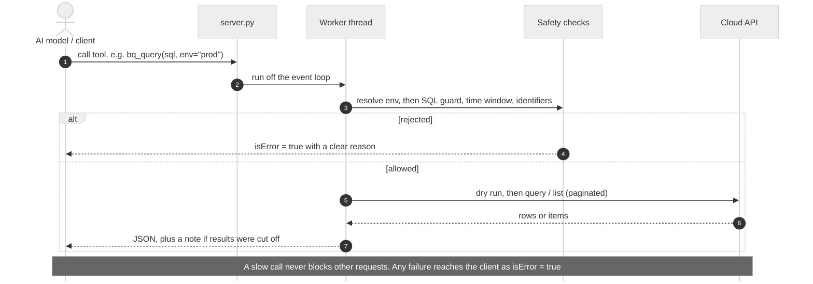
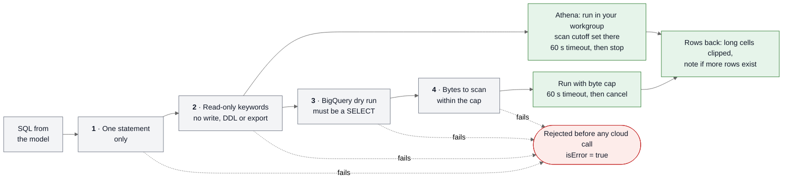

# Multi-Cloud MCP Server

A local [Model Context Protocol](https://modelcontextprotocol.io) server that gives an MCP client (such as **Claude Code**, **Codex**, **GitHub Copilot**, etc.) tools to inspect and query your own **Google Cloud Platform** (**GCP**) and **Amazon Web Services** (**AWS**)  infrastructure: data warehouses, CI build systems, container/serverless runtimes, and their logs. You point it at your own project(s) and account(s) through a short interactive setup wizard.

Built with: **Python**, the **Model Context Protocol** (**FastMCP**, stdio), **boto3** and the **Google Cloud client libraries**, covering **Google BigQuery**, **Google Cloud Run**, **Google Cloud Build**, **Google Cloud Logging**, **Amazon Athena**, **Amazon Elastic Container Service** (**Amazon ECS**), **AWS Lambda**, **AWS CodeBuild**, **Amazon Simple Storage Service** (**Amazon S3**) and **Amazon CloudWatch Logs**; tested with **pytest** and **moto**, and checked on every push by **GitHub Actions**.

[](https://github.com/anandapurva55/multi-cloud-mcp-server/actions/workflows/tests.yml)


[](LICENSE)

## Table of contents

- [Quickstart](#quickstart)
- [How it works](#how-it-works)
- [File by file](#file-by-file)
- [Configuring environments](#configuring-environments)
- [GCP auth modes](#gcp-auth-modes)
- [AWS auth modes](#aws-auth-modes)
- [Tool catalog with examples](#tool-catalog-with-examples)
- [Safety and cost controls](#safety-and-cost-controls)
- [Least-privilege permissions](#least-privilege-permissions)
- [Extending with a new service](#extending-with-a-new-service)
- [Testing](#testing)
- [Troubleshooting](#troubleshooting)
- [Security](#security)
- [License](#license)

## Quickstart

```bash
python3 -m venv .venv
source .venv/bin/activate
pip install -r requirements.txt

python3 setup_wizard.py    # interactive: configure your GCP and/or AWS environments
python3 server.py          # runs the MCP server over stdio
```

Point your MCP client at `server.py` as the command to run (with the same `.venv` interpreter). For example, in Codex's `config.toml` or the `mcp.json` that GitHub Copilot reads, the command is the absolute path to `.venv/bin/python3` and the argument is the absolute path to `server.py`.

**Where the configuration is read from.** The server reads the `.env` that sits next to `server.py`, *not* the `.env` of whatever directory the client happens to launch it from (MCP clients such as Codex and Cursor usually don't start servers in the repo directory). To use a different file, set `MULTICLOUD_MCP_ENV_FILE=/absolute/path/to/file.env`. Real environment variables take precedence over the file, so an `"env": {...}` block in your MCP client config can override individual settings. If the configuration is invalid (a typo'd `AUTH_MODE`, a missing project ID, two environment names that collide), the server exits at startup with a message saying what to fix instead of running half-configured.

## How it works

**The big picture.** An AI client talks to `server.py` over stdio. The server reads your configured environments from `.env`, and only registers tools for the providers you actually set up. Each tool goes through the same wrapper and safety helpers before it reaches a cloud API.


*The picture is generated by [`docs/diagrams/architecture.py`](docs/diagrams/architecture.py) (needs `pip install diagrams` and Graphviz); edit the script and re-run it to change the diagram.*

**What happens on one tool call.** The call is handed to a worker thread so a slow cloud request never freezes the server. Checks run before anything is sent to the cloud, and every failure comes back to the client as a real error (`isError = true`), not as text that looks like data.



**How a query is kept read-only and cheap.** `bq_query` and `athena_query` pass every statement through these checks. The checks are defence in depth; the real protection is a read-only role (see [Least-privilege permissions](#least-privilege-permissions)).



Every tool function takes an optional `env=` argument naming which configured environment to act against (for example `env="prod"`). If you omit it, the tool falls back to whichever environment the wizard set as the default for that provider. Call the always-available `list_environments` tool to see what is currently configured and which environment is the default for each provider.

## File by file

- **`server.py`**: the entry point. At import time it reads `config.CONFIG` and registers only the tool modules for providers that actually have a configured environment (a GCP-only setup never exposes AWS tools, and vice versa). It also defines one provider-agnostic tool, `list_environments`, directly. If neither provider is configured it prints a message to stderr and exits with status 1, rather than hanging waiting for input, because the stdio transport is reserved for MCP protocol traffic once an MCP client has launched it.

- **`config.py`**: the configuration model. Defines `GCPEnvironment` and `AWSEnvironment` dataclasses, an `AppConfig` registry keyed by environment name, `load_config(path)` to parse a `.env` file into an `AppConfig`, `render_env_file(cfg)` and `save_config(cfg, path)` to write one back out, and a `slug(name)` helper that turns an arbitrary environment name into the uppercase, underscore-separated form used in `.env` key names (so `"client-a-prod"` becomes the key prefix `CLIENT_A_PROD`). `AppConfig.resolve_gcp(env)` / `resolve_aws(env)` are what every tool calls to turn an `env=` argument (or `None`) into a concrete environment object, raising a `ValueError` that lists what is actually configured if the name does not exist.

- **`setup_wizard.py`**: the interactive onboarding flow. Run it any time, it loads whatever `.env` already exists, lets you add, remove, or change the default environment for either provider through a numbered menu, verifies each new environment's credentials as you add it (a live BigQuery/STS call, non-fatal for GCP, prompts to save-anyway for AWS on failure), and regenerates the keys it manages on save while preserving any other lines you added to `.env` by hand. It refuses environment names that would collide once converted to `.env` key prefixes (`client-a` vs `client_a`).

- **`live_check.py`**: a standalone smoke test you can run any time against your real `.env` to confirm a configured environment's credentials still work, without needing the full pytest suite or any specific cloud resources to exist. See [Testing](#testing) below.

- **`providers/errors.py`** and **`providers/tools.py`**: `cloud_tool(mcp)` is the decorator every tool uses. It (1) runs the blocking cloud SDK call in a worker thread so one slow query can't freeze the stdio server, (2) turns any exception (an unknown environment, an expired credential, an API failure) into an MCP `isError=true` result carrying a readable message, so clients and models can tell a failure from real data, and (3) marks the tool `readOnlyHint=true` / `destructiveHint=false`.

- **`providers/sql_guard.py`**, **`providers/output.py`**, **`providers/aws/paging.py`**, **`providers/timewindow.py`**, **`providers/gcp/filters.py`**: small shared helpers. The SQL guard that keeps the query tools read-only; output shaping (long cells are clipped, and any result that was cut off ends with an explicit note so a model can't mistake a partial list for the whole); boto3 pagination with a cap; `since_minutes`/`until_minutes` validation; and safe quoting of values placed into Cloud Logging / Cloud Build filter strings.

- **`providers/gcp/auth.py`**: resolves GCP credentials for a `GCPEnvironment`, either via Application Default Credentials (`google.auth.default()`) or a service-account JSON key file, and exposes `get_access_token()` for the one tool module that talks to a GCP REST API directly instead of through a client library.

- **`providers/gcp/bigquery_tools.py`**: `bq_list_datasets`, `bq_list_tables`, `bq_describe_table`, `bq_query`, `bq_preview_table`. Wrappers around the `google-cloud-bigquery` client. `bq_query` is read-only, dry-run first and byte-capped (see [Safety and cost controls](#safety-and-cost-controls)); `bq_preview_table` reads rows directly with `list_rows`, which is free and never scans the table the way `SELECT *` would.

- **`providers/gcp/cloudbuild_tools.py`**: `cloudbuild_list_builds`, `cloudbuild_get_logs`, `cloudbuild_describe_build`. There is no official Cloud Build Python client used here; it calls the REST API directly with a bearer token from `auth.py`, and fetches build logs straight from the build's GCS logs bucket (the last ~200 KB of a large log). Cloud Build keeps *global* builds (`projects/{p}/builds`, which is where default triggers write and what `gcloud builds list` shows) separately from builds in each *region* (`projects/{p}/locations/{r}/builds`), and each endpoint returns only its own. The tools therefore query both, merge, de-duplicate and sort by time, and say in the output which collections were searched. A `region` argument selects a different region (or `global` for global only).

- **`providers/gcp/cloudrun_tools.py`**: `cloudrun_list_services`, `cloudrun_describe_service`, `cloudrun_list_revisions`, `cloudrun_get_logs`, `cloudrun_get_error_logs`. Uses `google-cloud-run` for service/revision metadata and `google-cloud-logging` for log retrieval, filtered by `severity>=ERROR` for the error-only variant. Cloud Run is regional, so the list/describe/revision tools take an optional `region` argument (default: the environment's configured region). The log tools match both Cloud Run services and Cloud Run jobs.

- **`providers/aws/auth.py`**: resolves a `boto3.Session` for an `AWSEnvironment`, either via a named profile (or the default credential chain) or explicit static keys, plus `verify_credentials()` (a thin `sts:GetCallerIdentity` wrapper used by both the wizard and the `aws_whoami` tool).

- **`providers/aws/logs_helpers.py`**: one shared `fetch_log_events()` function used by the ECS, Lambda and CodeBuild tools. CloudWatch's `filter_log_events` has no descending order, `limit` only caps a single page, and a page can be empty while a `nextToken` still points at more matches. So it searches a bounded time window (`since_minutes`, default 60, up to 30 days; optional `until_minutes`), follows `nextToken` to the end of the window, and returns the *last* N events, i.e. the most recent. It stops after 100 pages and says so if it had to. The error filter is a CloudWatch Logs filter pattern (`?ERROR ?Error ?CRITICAL ?FATAL ?Exception ?Traceback`), since CloudWatch has no built-in structured severity field the way GCP's logging API does.

- **`providers/aws/athena_tools.py`**: `athena_list_databases`, `athena_list_tables`, `athena_describe_table`, `athena_query`, `athena_preview_table`. This is the closest AWS equivalent to BigQuery: a serverless SQL engine over the Glue Data Catalog. Unlike BigQuery, a query is asynchronous (start, then poll for completion, then fetch results), so `athena_query` polls (with a short backoff) for up to 60 seconds, then cancels the query so it doesn't keep running and billing. `athena_get_query_results(query_id)` fetches the rows of an earlier query by ID. An optional per-environment workgroup (`AWS_ENV_<NAME>_ATHENA_WORKGROUP`) is passed to every query.

- **`providers/aws/codebuild_tools.py`**: `codebuild_list_projects`, `codebuild_list_builds`, `codebuild_get_logs`, `codebuild_describe_build`. The CodeBuild equivalent of the Cloud Build tools.

- **`providers/aws/ecs_tools.py`**: `ecs_list_clusters`, `ecs_list_services`, `ecs_describe_service`, `ecs_list_tasks`, `ecs_get_logs`, `ecs_get_error_logs`. Covers the container half of what Cloud Run does in one service on GCP; the log tools resolve the right CloudWatch log group automatically from the service's task definition.

- **`providers/aws/lambda_tools.py`**: `lambda_list_functions`, `lambda_describe_function`, `lambda_list_versions`, `lambda_get_logs`, `lambda_get_error_logs`. Covers the serverless-function half of Cloud Run's niche. A function's log group is always `/aws/lambda/<function_name>`, so no extra lookup is needed before fetching logs.

- **`providers/aws/s3_tools.py`**: `s3_list_buckets`, `s3_list_objects`. Bonus coverage beyond the GCP tool set's shape.

- **`providers/aws/identity_tools.py`**: `aws_whoami`. Bonus coverage: confirms which AWS account and identity a named environment actually resolves to, useful once you have several environments configured.

## Configuring environments

An "environment" is a named GCP project or AWS account/region you want the server able to talk to. You can configure any number of them under any names you like: `dev`, `prod`, `client-a-prod`, whatever makes sense to you. Run the wizard to add one:

```
$ python3 setup_wizard.py
=== Multi-Cloud MCP Setup Wizard ===

Loaded 0 GCP environment(s): (none)
Loaded 0 AWS environment(s): (none)

Main menu:
  1) Add a cloud environment
  2) Remove an environment
  3) Set default environment for a provider
  4) Save and exit
  5) Exit without saving
Choose [1-5]: 1
Provider?
  1) gcp
  2) aws
Choose [1-2]: 1

--- Add GCP environment ---
Environment name (e.g. 'dev', 'prod', 'client-a-prod'): prod
GCP project ID: my-real-project-id
Region [us-central1]:
Auth method:
  1) Application Default Credentials (gcloud auth application-default login)
  2) Service account JSON key file
Choose [1-2]: 1
Verifying...
  Auth OK.
  BigQuery smoke test OK.
Added GCP environment 'prod'.
```

Re-run the wizard any time to add another environment, remove one, or change which one is the default. It always reloads whatever `.env` already exists first, so nothing you have already configured is lost.

## GCP auth modes

Chosen per environment, in the wizard:

- **Application Default Credentials** (**ADC**): run `gcloud auth application-default login` once beforehand, or rely on the default service account if this is running inside GCP itself.
- **Service account JSON key file**: point the wizard at a downloaded key file. Useful if you do not have `gcloud` installed at all. The path is stored in `.env` as `GCP_ENV_<NAME>_CREDENTIALS_PATH`.

## AWS auth modes

Also chosen per environment, in the wizard:

- **Named profile** (recommended): set one up first with `aws configure` or `aws configure sso`. No secrets are ever written to `.env`, only the profile name.
- **Access key and secret**: pasted directly into `.env` for an environment with no AWS CLI configured at all. `.env` is git-ignored and the wizard sets its file permissions to `600`, but a profile is still the safer choice when you have one available.

## Tool catalog with examples

Every tool below also accepts an optional `env` argument; it is omitted from the example calls where the default environment is being used.

### BigQuery (GCP)

```
bq_list_datasets()
→ Project: my-real-project-id
    part_catalog
    analytics

bq_query(sql="SELECT id, name FROM `my-real-project-id.part_catalog.part_level`", max_results=2)
→ [
    {"id": "A100", "name": "Bearing"},
    {"id": "A101", "name": "Gasket"}
  ]
  [Showing the first 2 rows; more rows are available. Add a LIMIT/WHERE, or raise max_results (max 100).]

bq_query(sql="DROP TABLE part_catalog.part_level")
→ (error) Only read-only queries are allowed ...
```

### Cloud Build (GCP)

```
cloudbuild_list_builds(branch="main", limit=5)
→ [
    {"id": "8f2e...", "status": "SUCCESS", "branch": "main",
     "createTime": "2026-09-01T10:02:00Z", "finishTime": "2026-09-01T10:06:00Z",
     "logUrl": "https://console.cloud.google.com/cloud-build/builds/8f2e..."}
  ]
```

### Cloud Run (GCP)

```
cloudrun_get_error_logs(service_name="my-service", limit=20, since_minutes=180)
→ [
    {"timestamp": "2026-09-01T10:05:12Z", "severity": "ERROR",
     "message": "connection refused: upstream timeout"}
  ]
```

### Athena (AWS)

```
athena_query(sql="SELECT id, amount FROM salesdb.orders LIMIT 2")
→ [
    {"id": "1", "amount": "9.99"},
    {"id": "2", "amount": "14.50"}
  ]
```

### CodeBuild (AWS)

```
codebuild_describe_build(build_id="my-project:abcd-1234")
→ {
    "id": "my-project:abcd-1234", "status": "SUCCEEDED",
    "startTime": "2026-09-01 10:00:00+00:00", "endTime": "2026-09-01 10:04:12+00:00",
    "sourceVersion": "main",
    "phases": [{"phaseType": "BUILD", "phaseStatus": "SUCCEEDED", "durationInSeconds": 42}]
  }
```

### ECS / Fargate (AWS)

```
ecs_get_error_logs(cluster="my-cluster", service_name="my-service", since_minutes=240, until_minutes=60)
→ [
    {"timestamp": 1767283512000, "logStream": "ecs/app/abc123",
     "message": "ERROR something broke"}
  ]
```

### Lambda (AWS)

```
lambda_describe_function(function_name="my-function")
→ {
    "name": "my-function", "runtime": "python3.12", "memorySize": 256, "timeout": 30,
    "handler": "lambda_function.handler", "role": "arn:aws:iam::123456789012:role/lambda-role",
    "lastModified": "2026-09-01T10:00:00.000+0000", "envVars": ["STAGE", "LOG_LEVEL"]
  }
```

### S3 (AWS)

```
s3_list_objects(bucket="my-bucket", prefix="logs/2026/09/", limit=5)
→ [
    {"key": "logs/2026/09/01.json", "size": 4021, "lastModified": "2026-09-01 00:05:00+00:00"}
  ]
```

### Identity (AWS)

```
aws_whoami()
→ Environment: prod
  Account:     123456789012
  ARN:         arn:aws:iam::123456789012:role/my-role
  Region:      us-east-1
```

### Always available

```
list_environments()
→ GCP environments:
    dev (default) - project: my-dev-project, region: us-central1
    prod - project: my-real-project-id, region: us-central1
  AWS environments:
    staging (default) - region: us-east-1
```

## Safety and cost controls

The server is meant to be pointed at real (including production) accounts, and the text it returns (log lines, table cells) is untrusted: a prompt injection inside a log line could try to get the model to run something destructive. So read-only is enforced in the server, not just assumed:

- **Query tools only run one read-only statement.** `bq_query` and `athena_query` reject anything that isn't a single `SELECT`/`WITH`/`SHOW`/`DESCRIBE`/`EXPLAIN`/`VALUES` statement, and reject write/DDL/export keywords anywhere in it (`INSERT`, `MERGE`, `DROP`, `CREATE` (including CTAS), `UNLOAD`, `EXPORT DATA`, ...), after blanking out comments and quoted text using each dialect's own quoting rules. `bq_query` additionally dry-runs the statement, and BigQuery itself must classify it as `SELECT`.
- **BigQuery cost cap.** The dry run reports how many bytes the query would scan; over the limit it is refused before running, and it also runs with `maximum_bytes_billed`. The limit is `GCP_ENV_<NAME>_MAX_BYTES_BILLED` (default 10 GB, set in the wizard). Queries time out after 60 s and are cancelled.
- **Athena cost cap.** Athena's scan limit belongs to the *workgroup*, not the query. Create a workgroup with a per-query data-scanned cutoff and enforced output location, and set `AWS_ENV_<NAME>_ATHENA_WORKGROUP` to it. Athena always writes result files to its output location, so `athena_query` is read-only with respect to your data but does create result objects there.
- **Every tool is annotated** `readOnlyHint=true`, `destructiveHint=false`, so clients can show that and skip per-call confirmation.
- **Failures are errors.** A failing tool returns an MCP `isError=true` result, not a success whose text starts with "Error".
- **Bounded output.** Lists are paginated up to 200 items and say when more exist; query results say when rows were cut off; individual cells are clipped at 2,000 characters; Cloud Build logs return the last ~200 KB.

The SQL check is a lexical, best-effort guard. It is defence in depth and **not a substitute for read-only credentials**, which is the next section. Known trade-off: a column or table that is literally named like a blocked keyword (`call`, `load`, `set`, ...) must be quoted (`` `set` `` / `"set"`) to pass. Pass-through functions that run a SQL *string* on another database (BigQuery's `EXTERNAL_QUERY`) are refused outright, because the guard cannot read the inner SQL.

## Least-privilege permissions

Give the credentials this server uses only what the tools need. Then even a bypass of the SQL guard, or a model talked into something odd, cannot change anything.

**GCP** (grant to the user or service account behind ADC / the key file):

| Tools | Role |
| --- | --- |
| BigQuery | `roles/bigquery.dataViewer` on the datasets to expose, plus `roles/bigquery.jobUser` on the project (needed to run queries; it does not allow writing data) |
| Cloud Run | `roles/run.viewer` |
| Logs | `roles/logging.viewer` |
| Cloud Build | `roles/cloudbuild.builds.viewer`, plus `roles/storage.objectViewer` on the Cloud Build logs bucket (for `cloudbuild_get_logs`) |

**AWS** (attach to the profile's role/user). The tools only call these actions:

```json
{
  "Version": "2012-10-17",
  "Statement": [
    {
      "Sid": "ReadOnlyForMultiCloudMcp",
      "Effect": "Allow",
      "Action": [
        "athena:ListDatabases", "athena:ListTableMetadata", "athena:GetTableMetadata",
        "athena:StartQueryExecution", "athena:GetQueryExecution", "athena:GetQueryResults",
        "athena:StopQueryExecution",
        "glue:GetDatabase", "glue:GetDatabases", "glue:GetTable", "glue:GetTables", "glue:GetPartitions",
        "codebuild:ListProjects", "codebuild:ListBuildsForProject", "codebuild:BatchGetBuilds",
        "ecs:ListClusters", "ecs:ListServices", "ecs:DescribeServices", "ecs:ListTasks",
        "ecs:DescribeTasks", "ecs:DescribeTaskDefinition",
        "lambda:ListFunctions", "lambda:GetFunction", "lambda:ListVersionsByFunction",
        "logs:FilterLogEvents", "logs:GetLogEvents",
        "s3:ListAllMyBuckets", "s3:ListBucket"
      ],
      "Resource": "*"
    }
  ]
}
```

Scope `Resource` down where you can. Athena also needs S3 access that this policy does not grant: `s3:GetObject`/`s3:ListBucket`/`s3:GetBucketLocation` on the buckets holding the data being queried, and `s3:PutObject` (plus the same read actions) on the Athena results location only. Keep results in a dedicated bucket and do **not** grant `s3:PutObject` anywhere else: that is what stops a CTAS or `UNLOAD` from writing data even if one got past the SQL guard. `sts:GetCallerIdentity` (used by `aws_whoami`) needs no permission.

## Extending with a new service

Every tool module follows the same shape: a `register(mcp)` function that defines its tool functions as closures decorated with `@cloud_tool(mcp)` (from `providers/tools.py`; this registers the tool as read-only, runs it in a worker thread and reports failures as `isError`), each resolving its environment through `CONFIG.resolve_gcp(env)` or `CONFIG.resolve_aws(env)`. To add a new service:

1. Create `providers/gcp/<service>_tools.py` or `providers/aws/<service>_tools.py` following that shape.
2. Add it to the relevant import list and registration loop in `server.py`.
3. Write a test file under `tests/gcp/` or `tests/aws/` using the `gcp_config` / `aws_config` fixtures described below.

Never hardcode a project ID, account ID, or region anywhere. Everything should flow through the resolved environment object.

## Testing

The test suite mocks every cloud call, so it runs with no real GCP or AWS credentials and makes no real cloud API calls (AWS tests run against [moto](https://github.com/getmoto/moto)'s in-memory AWS simulation, or against faithful fakes where moto doesn't model the behavior under test, such as CloudWatch's oldest-first paging, ECS's paging, and Cloud Build's global/regional split). The one exception: the subprocess wizard tests run the wizard's real credential check, which makes a harmless BigQuery call if Application Default Credentials exist on your machine.

```bash
pip install -r requirements-dev.txt
python3 -m pytest tests/ -v
```

`tests/conftest.py` provides two fixtures used throughout: `gcp_config(module)` and `aws_config(module)`, which each monkeypatch a tool module's `CONFIG` to a fake, single-environment `AppConfig`. AWS tests wrap their body in moto's `@mock_aws` decorator and use fake static keys, so the real `providers/aws/auth.py` code path runs end to end against moto's simulated AWS rather than mocking authentication away. GCP has no equivalent in-memory emulator, so GCP tests mock at the client-class boundary instead (`bigquery.Client`, `run_v2.ServicesClient`, and so on).

`tests/test_errors.py` drives tools through a real in-memory MCP client/server session to prove failures arrive as `isError=true` and that a slow tool doesn't block the event loop. `tests/test_sql_guard.py` is the adversarial suite for the read-only SQL check. Tests never read or write the repo's real `.env`: an autouse fixture points `MULTICLOUD_MCP_ENV_FILE` at a temp file.

`tests/test_server.py` and `tests/test_setup_wizard.py` run the real scripts as subprocesses in an isolated temporary working directory, since both have import-time or interactive side effects that are not safe to exercise by importing them directly inside the test process.

### Live smoke test

The mocked suite proves the code is correct in isolation, but it can't catch things like a mistyped project ID, an API that isn't enabled, or an expired credential. `live_check.py` covers that gap: it reads your real `.env` and makes one real, read-only call per configured environment (an actual credential fetch plus a lightweight BigQuery call for GCP, an actual `sts:GetCallerIdentity` for AWS), so it exercises the exact same auth code path the real tools use, without needing you to have any specific resources (datasets, buckets, functions) already set up.

```bash
python3 live_check.py                # check every configured environment
python3 live_check.py --env prod     # check only one environment by name
python3 live_check.py --provider aws # check only one provider
```

It reads the same `.env` as the server (next to `server.py`, or `MULTICLOUD_MCP_ENV_FILE`).

This was run against a real GCP project and a real AWS account during development: BigQuery, S3, Lambda, ECS, CodeBuild, and Athena all round-tripped successfully end to end (each reporting empty results, since those particular resources had nothing in them yet), and Cloud Run / Cloud Build correctly surfaced real "API not enabled" errors as clean messages instead of a raw traceback, confirming the error-handling path works against real failures too, not just mocked ones. Note that those runs predate the fixes described in [Safety and cost controls](#safety-and-cost-controls), and that Cloud Run / Cloud Build had never been exercised against real data.

## Troubleshooting

- **"No cloud providers configured"** on startup: run `python3 setup_wizard.py`.
- **"Invalid configuration: ..."** on startup: the message names the exact `.env` key to fix.
- **Server finds no config when launched from an MCP client** (Codex, Cursor, ...): it reads the `.env` next to `server.py`; run `python3 setup_wizard.py` from the repo (it prints the path it writes), or set `MULTICLOUD_MCP_ENV_FILE`.
- **"Query would process N bytes, over this environment's limit"**: filter on a partition/clustering column, select fewer columns, or raise `GCP_ENV_<NAME>_MAX_BYTES_BILLED`.
- **"Query rejected: contains write/DDL keyword(s) ..."**: the server is read-only by design; if a column is literally named like a keyword, quote it.
- **Log tools return nothing**: they search the last 60 minutes by default; pass `since_minutes` (up to 43200) to look further back.
- **"Unknown GCP/AWS environment '...'"**: the error message lists what is actually configured; use one of those names, or add a new one with the wizard.
- GCP ADC issues: `gcloud auth application-default login`.
- AWS profile issues: `aws sts get-caller-identity --profile <name>` to test outside the wizard.

## Security

This server is read-only by design, but the real protection is the credentials you give it: run it with a read-only role (see [Least-privilege permissions](#least-privilege-permissions)). To report a vulnerability, see [SECURITY.md](SECURITY.md).

## License

Released under the [MIT License](LICENSE).
